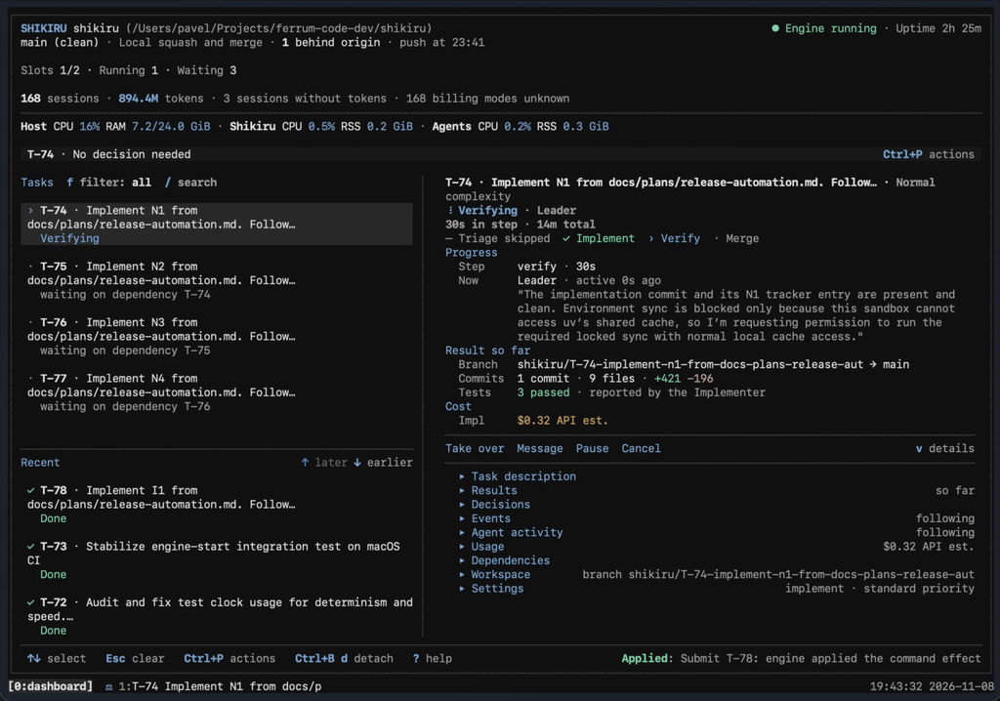

# Shikiru (しきる)

[](https://github.com/ferrum-code-dev/shikiru/releases)
[](https://github.com/ferrum-code-dev/shikiru/blob/main/LICENSE)
[](https://github.com/ferrum-code-dev/shikiru/actions/workflows/ci.yml)

Shikiru coordinates coding agents through a development workflow: request in, reviewed change out.
It asks you when a decision needs human judgment. It runs locally with Git worktrees, a persistent
engine and a terminal dashboard in tmux. Claude Code and Codex CLI are built in; different agents
and models can take different roles on the same task.

Routine escalations handled for you, the rest sent to your phone? See
[shikiri-yaku](https://github.com/ferrum-code-dev/shikiri-yaku).



## Contents

- [How it works](#how-it-works)
- [Requirements](#requirements)
- [Install and update](#install-and-update)
- [Quick start](#quick-start)
- [CLI](#cli)
- [Dashboard](#dashboard)
- [Agents and recovery](#agents-and-recovery)
- [Configuration and integration](#configuration-and-integration)
- [Persistence](#persistence)
- [Safety](#safety)
- [Contributing and design](#contributing-and-design)

## How it works

| Role | Responsibility |
| --- | --- |
| **Operator** | You. Submit requests, set policy, inspect results, answer decisions. |
| **Leader** | Triages requests, plans larger work, answers questions, reviews changes. |
| **Implementer** | Changes code, runs checks, updates trackers, resolves conflicts. |
| **Helper** | Rebuilds missing reports or classifies unknown failures. Does not run the workflow. |
| **Engine** | Deterministic coordinator: schedules tasks, validates reports, manages Git, records state. |

Each request gets a task ID (`T-1`), a branch and a worktree. The Leader routes it:

- **Implement:** the Implementer changes code. The Leader accepts, requests another iteration,
  raises a decision, or replaces the task.
- **Plan:** the Leader commits a plan and can create dependent tasks. A plan-only request can end there.

Accepted work rebases onto the base branch and integrates locally or through a GitHub pull request.
Requests needing your input become **escalations** (`E-1`, etc.) with answer options. Other tasks
keep running.

## Requirements

- Python 3.14+ and [uv](https://docs.astral.sh/uv/).
- Git 2.45+ and tmux 3.5+.
- One Git repository per project, with at least one commit at its root. No submodules or multi-repo projects.
- Claude Code or Codex CLI, installed and signed in.
- `gh` and a GitHub remote, only for pull-request integration.

## Install and update

```sh
uv tool install shikiru-cli
shikiru --help
```

The distribution is `shikiru-cli`; the command is `shikiru`. Avoid `--editable` for a long-running
install, since it follows the working tree.

Update, then restart each project with a running engine. The engine keeps the code it started with:

```sh
uv tool upgrade shikiru-cli
shikiru restart          # refuses while a task runs; add --force to override
```

The tmux dashboard also keeps its old code. Reload it with either:

- `shikiru restart --kill-session` (closes the session and its panes, then starts a new one), or
- `shikiru restart`, then in the dashboard window enter `respawn-window -k` at the tmux prompt (`Ctrl+b`, then `:`).

Go back to a release:

```sh
uv tool install shikiru-cli==<version>
shikiru restart
```

Develop from a checkout: see [CONTRIBUTING.md](CONTRIBUTING.md). CI runs on Ubuntu 24.04 and macOS 15.

## Quick start

From the root of a committed project repository:

```sh
cd /path/to/project
shikiru init
shikiru doctor
shikiru start
shikiru submit "Fix a small, specific issue and verify it"
shikiru attach
```

`init` runs a wizard: it checks the repository, sets agent ladders, tracker and cache paths,
orchestration limits and integration mode, reviews each agent's options, then writes
`.shikiru/config.toml` and runs Doctor. Cancel with the Cancel button.

- `shikiru init --yes` writes editable defaults with model placeholders. Replace them with models your
  agent supports, then run `doctor`.
- `shikiru doctor` checks setup without running task turns. `doctor --probe` also runs live checks and
  can use paid provider usage.

## CLI

Commands find the nearest `.shikiru/` above the current directory. Use `--project PATH` to choose one
explicitly. `--help` on each command lists its options.

| Command | Use |
| --- | --- |
| `init` | Configure a repository. `--yes` writes defaults. |
| `start` | Start or reuse the engine and its tmux session. `--attach` enters it. |
| `stop` | Stop orchestration, keep state and panes. `--kill-session` also closes the tmux session. |
| `restart` | Stop and start the engine so it runs installed code. `--kill-session` also replaces the tmux session. |
| `submit "REQUEST"` | Queue work and print its task ID. |
| `status` | Engine, queue, tasks, escalations, usage. `status T-1` for one task; `--watch` for updates. |
| `ls` | List project sessions. `--host HOST` queries over SSH. |
| `attach` | Attach to the current project, or pick a numbered session. |
| `doctor` | Diagnose requirements, config, plugins and state. `--probe` adds live checks. |
| `mcp` | Serve operator tools over stdio to an MCP client. |

```sh
shikiru submit --mode implement --complexity high --priority 10 --after T-1 "Implement the accepted design"
shikiru status T-2 --watch
shikiru --json status
shikiru --project /path/to/project --set orchestration.max_parallel=1 start
```

- `--after` is repeatable. `--leader` and `--implementer` pin a role as `agent:model[:effort]`.
- `--json` gives machine-readable output.
- `--kill-session` on `stop` or `restart` closes the project's tmux session only after the engine has
  stopped. Closing it disconnects every attached client and terminates the processes in its panes,
  including the dashboard. Run it from a shell outside that session, since closing the session also
  ends the command running in it. `restart` then creates a new session.
- A task ID means the request was recorded, not finished. Check `status` or the dashboard.
- Deleting `.shikiru/` loses its state. `init` creates new state; it does not recover old tasks.
- One attached client per project session. Detach the first client before attaching from another terminal.

## Dashboard

- **Home:** engine, repository state, queue, active work, decisions, usage.
- **Task details:** briefing, results, dependencies, reports and Git evidence, activity, sessions.
- Keys: `Up`/`Down` select, `f` filter by status, `/` search, `m` load older tasks, `?` help.

Open **Actions** with `Ctrl+P` or `F12`, or your tmux prefix then Space. They apply to the selected
task and role. Availability depends on state; **More…** shows the rest.

| Action | Effect |
| --- | --- |
| Submit / Prioritize | Add work or change dispatch priority. |
| Message | Send guidance to a role at its next turn. |
| Take over / Hand back | Stop automation and drive the role's agent interactively. Hand back returns control to the engine. |
| Pause / Resume | Hold after the current turn, or interrupt now. Other tasks continue. |
| Rung | Switch a role's agent, model or effort from its next turn. |
| Open session | Inspect a role's activity without taking over. |
| Retry / Cancel | Re-run the current step, or abandon the task and keep its branch. |
| Answer | Resolve an escalation with an offered choice or your own answer. |
| Export | Write task evidence as Markdown or JSON. |
| Command history / Diagnostics | Inspect commands, engine health and faults. |

Tmux: each task has a window with a pane per role. Default prefix `Ctrl+B`; prefix then `d` detaches
without stopping the engine. `shikiru attach` reconnects.

## Agents and recovery

- **Rung:** one agent, model and effort choice.
- **Ladder:** ordered rungs. Shikiru moves down under its recovery policy, even to another provider.
- Leader and Implementer have their own ladders. Implementer also has `low`, `normal` and `high`
  complexity ladders.

A rung in `.shikiru/config.toml` is a string `"agent:model"` or `"agent:model:effort"`, or a table
`{ agent, model, effort }`. Forms can mix in one ladder:

```toml
[roles.leader]
ladder = ["codex:gpt-6.1-sol:high", { agent = "claude", model = "claude-sonnet-5-5" }]
```

Use the table form when a model or effort contains `:` or effort is empty.

Recovery, in short:

- **Rejected work:** another review iteration, possibly on a stronger rung.
- **Provider unavailable:** bounded backoff, then fallback.
- **Quota:** waits for reset, or moves to another provider's rung when the wait budget runs out.
- **Stall:** limited continuation attempts.
- **Auth failure or exhausted limits:** asks you. Nothing completes silently.

Quota waits show `⧗ quota` in the task's tmux tab and a `⧗ Quota blocked` strip in each affected pane.
Reset times use your local timezone. Token counts, cost and billing appear only when the agent reports them.

## Configuration and integration

Settings merge in order: packaged defaults, then `.shikiru/config.toml`, then `--set key.path=value`
for one invocation. A running engine keeps its settings; stop and start it to apply policy changes.
An invalid config keeps the last valid values and shows a header alert.

The complete list of fields and defaults is in
[defaults.toml](src/shikiru/config/defaults.toml) and [settings validation](src/shikiru/config/settings.py).
Design details are in [the design](docs/design.md#configuration-observability-and-extensions).

### Integration

Set `orchestration.integration`:

- **`merge`:** rebase and apply accepted work to the local base.
- **`squash`:** land the task as one commit on the current base, with its full tree.
- **`pr`:** push the task branch, open or adopt a GitHub PR, and wait for merge.

Shikiru never bypasses repository review policy. Task commits follow the project's documented commit
convention, or Conventional Commits, and carry a `Task: T-n` trailer.

With `pr`, `orchestration.pr_feedback` picks which reviews start a feedback round: `changes_requested`
(default) or `any_comment`. Shikiru never dismisses reviews, resolves threads, approves or merges. A PR
closed without merge escalates; only an explicit retry opens a new PR.

If the local base cannot fast-forward to the merged remote tip, the task escalates as integration
blocked and your uncommitted work is left untouched. Resolve it, then retry.

### Pushes

In `merge` and `squash` modes, `orchestration.push_interval_seconds` (default `14400`) sets how often
the base branch is pushed. Pushes are never forced, and task branches and tags are never pushed.
`0` pushes after every integration. A rejected push is retried with backoff. An unconfigured remote
is rechecked every `orchestration.remote_recheck_seconds` (default `60`). Pending work survives restarts.

### Caches, notifications and retries

- **Caches:** selected Git-ignored paths can be cloned into task worktrees with copy-on-write. If the
  filesystem cannot, Shikiru warns and skips them; it never silently makes a full copy.
- **Notifications:** tmux messages and an optional `notify` command report completions, escalations,
  waits and faults. Hooks should tolerate duplicates after a crash.
- **Retries:** `[orchestration.retries]` sets provider-unavailable backoff. Defaults: 30 s, ×4, 300 s
  maximum, 3 retries. Engine-tick retries are separate, under `[orchestration.faults]`.

### Automation and plugins

- CLI `--json` and the MCP server (`shikiru mcp`) expose the same operator services as the dashboard.
  The [MCP tools](src/shikiru/mcp/server.py) are the contract.
- Agent and widget plugins use Python entry points. Start from the
  [agent contract](src/shikiru/agents/contracts.py), [SDK](src/shikiru/agents/sdk/) and
  [contract test kit](src/shikiru/agents/testing/).

## Persistence

The engine runs independently of the terminal. `shikiru start` reloads state, reconciles unfinished
work and resumes eligible tasks.

- **Detach:** ends your connection only.
- **Stop:** interrupts running turns and ends orchestration. State and tmux session remain.
- **Pause or cancel one task:** other tasks keep going.

| Path | Contents |
| --- | --- |
| `.shikiru/config.toml` | Project settings. |
| `.shikiru/state.db` | Tasks, commands, events, sessions, decisions. |
| `.shikiru/backups/` | `state.db` copies from before each schema migration. The newest three are kept. |
| `.shikiru/worktrees/` | Per-task Git checkouts. |
| `.shikiru/runs/` | Prompts, reports, facts, streams and logs. |
| `.shikiru/logs/engine.log` | Rotating engine log. |

Use `doctor` for setup problems, `status` for progress, and dashboard Diagnostics for live faults.
Retention removes finished evidence after configured horizons; export anything you need to keep.
To roll back a migration, stop the engine and copy the newest file in `.shikiru/backups/` over `state.db`.
Do not repair corrupt state by deleting `.shikiru/`.

## Safety

Shikiru orchestrates agents; it does not sandbox them.

- Agents run as your user, with your environment and credentials. Use only repositories and hosts you trust.
- Claude Code defaults to `--permission-mode bypassPermissions`.
- Codex uses `workspace-write`, which includes the shared repository `.git`. Agents can change Git
  refs, hooks and configuration.
- Worktrees separate task files but do not isolate tasks from the main checkout or each other.
- Project instructions and notification commands run with your privileges.
- Prompts, reports and exports can contain sensitive content. Review them before sharing.

Review changes and commits before you trust them. A passing agent review does not prove correctness.

## Shikiri-yaku

[Shikiri-yaku](https://github.com/ferrum-code-dev/shikiri-yaku) is a companion service that watches
your projects' escalations, handles routine ones (retries, quota waits, restarts, approved installs)
and forwards the rest to Telegram. It uses only `shikiru mcp` and the CLI.

## Contributing and design

See [CONTRIBUTING.md](CONTRIBUTING.md) for validation, real-agent checks and releases.
[The design](docs/design.md) explains architecture and invariants. Interface references:
[CLI examples](docs/design/references/cli-output-examples.html) and
[dashboard reference](docs/design/references/dashboard-example.html).
