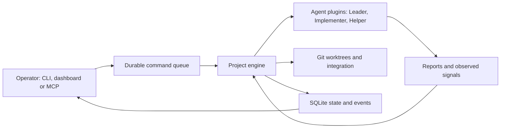

# Design

Shikiru is a local coordinator for coding agents. It turns Operator requests into tasks, runs a
fixed development/review workflow and integrates accepted changes. Agents propose results through
structured reports; engine code validates them and decides what can happen next. The
[README](../README.md) describes the complete user-facing capability set and operating commands.

## Participants and terms

| Term | Meaning |
| --- | --- |
| Operator | The person submitting work, configuring policy, resolving decisions and intervening in sessions. |
| Leader | The agent role for triage, planning, implementation consultation and review. |
| Implementer | The agent role that changes code, verifies its changes, updates selected trackers and repairs integration conflicts. |
| Helper | A headless support role that reconstructs a missing report or classifies an unrecognized failure; it cannot approve work or choose workflow transitions. |
| Engine | One asynchronous orchestration process per project, protected by a project lock. |
| Task / escalation | A persisted request (`T-n`) and a decision requiring Operator input (`E-n`). |
| Agent / rung / ladder | A provider CLI plugin; one agent/model/effort choice; an ordered sequence of those choices. Roles are responsibilities, so they may use the same agent or different agents. |
| Turn / session / slot | One prompted agent execution; its resumable provider conversation; capacity for one running task. A session can span multiple turns. |

The project is one committed Git repository. Each task receives its own branch and worktree under
`.shikiru/worktrees/`, keeping concurrent task files separate. Tracker files are optional project
plans/checklists included in agent context and updated as work proceeds. Optional ignored caches
are cloned into worktrees using copy-on-write; unsupported filesystems produce a warning and no
cache clone. Neither worktrees nor cache cloning are a sandbox.

## Components and authority

Operator services are shared by CLI, Textual/tmux dashboard and stdio MCP. Readers expose stored
state and collected evidence; mutations enter a typed durable command queue. An acknowledgement
records whether a command is pending, applied or rejected, not whether its task is complete. Submit
allocates the task ID at enqueue time. The engine owns task-state transitions; UI clients and
agents do not directly choose state changes.

SQLite records tasks, holds, dependencies, commands, events, agent runs/sessions, escalations,
quota and recovery facts. Turn directories under `.shikiru/runs/` contain prompts, facts, reports,
streams and diagnostics. Git is the authority for branches, commits, cleanliness and integration;
agent statements about Git are not accepted as a substitute for observed repository facts.

## Workflow

1. **Triage:** Leader selects an implementation or planning route and task complexity. Explicit
   submission mode skips triage; supplied complexity or role overrides take precedence.
2. **Plan route:** Leader commits planning/tracker changes. A request to execute the plan can emit
   follow-up tasks with dependencies; a planning-only request need not emit work. The plan task
   integrates its changes. Follow-up tasks are scheduled when their dependencies are satisfied.
3. **Implement route:** Implementer changes the task worktree and reports its changes/checks.
   Questions can go to Leader consultation; unresolved judgment becomes an escalation.
4. **Review:** Leader accepts, requests rework, escalates, or supersedes the task with replacement
   tasks. Rework consumes a bounded iteration budget and may advance the Implementer ladder.
   Supersession repoints dependents to replacement work rather than silently dropping it.
5. **Integration:** Engine rebases accepted work onto the selected base and applies the configured
   strategy. Conflicts invoke bounded Implementer repair and Leader verification. Completion is
   recorded only after integration settles; an open PR is still unfinished work.

Each turn receives the request, relevant earlier reports, Operator messages and workspace facts.
A report must match the expected schema and allowed outcomes. Accepting or superseding a task with
uncommitted work or the wrong checked-out task branch is rejected by engine checks. This validates
the workflow contract; it does not establish the correctness of the implementation or its tests.

## Scheduling, agent selection and recovery

The scheduler respects dependency completion, task priority, available parallel slots, task holds,
CPU/free-RAM dispatch gates and provider quota blocks. A cancelled prerequisite cancels dependent
queued work. Limits on dispatch do not cap resources already-running agent processes can consume.
When a queued task's selected agent has a quota block beyond `max_quota_wait` (in seconds),
the scheduler advances that role to the next unblocked agent in its ladder. Shorter blocks wait
for reset; without an available later agent, the task stays queued until the block expires.

A persisted quota block is a prediction, not a lock. While a task waits on a block, in a turn's
quota wait or queued, including after an engine restart, the engine revalidates it every
`[orchestration.quota_refresh] interval_seconds` by asking the agent plugin's optional
`read_quota(since)` capability for a fresh reading. The capability is a blocking call: the engine
runs it on a daemon thread of its own, at most one per agent, and a read that never returns cannot
be interrupted, so it is neither replaced nor waited for. While it is outstanding, the agent's next
probe is refused as an `engine_fault` instead of starting another thread, and shutdown leaves it
behind without delaying process exit. Probes are supervised background work, never
part of the scheduling tick: a tick starts at most one probe per blocked agent, bounded by
`timeout_seconds` on the injected clock, and neither independent dispatch nor Operator command
acknowledgement waits for it. The probe's reading is consumed when it completes, and the next tick
sees the outcome. A probe whose block has since been replaced is cancelled and its reading dropped;
shutdown cancels every probe in flight. An Operator retry forces one revalidation. A block records
when it was set; it is released only by readings observed after that instant, and no earlier than
the stored sample of the same window, that show no exhausted window and cover every window the
block was exhausted on, whose reset is unknown or still ahead (`domain.quota_blocks`). A missing
reset is not proof that a window expired. Older samples, other quota buckets, null or missing
windows and the mere passing of an interval never release a block. A block's deadline and set time
are written in one transaction, and opening a database repairs rows left half-written by earlier
versions: a deadline without a set time gets the upgrade time, so only a newer reading releases it,
and a set time without a deadline is dropped. A plugin without the capability, or a probe that
finds nothing newer, keeps the block until its deadline; a probe that fails or times out is an
`engine_fault` (and `engine_recovered` later), never silently ignored. The
Codex plugin answers from the `limit_id: codex` bucket of its rollouts: a trailing event of another
bucket with null windows does not replace the latest usable Codex reading.

Leader and Implementer resolve their own ordered ladders; Implementer can select a low/normal/high
complexity override, otherwise its base ladder applies. A task-specific rung override selects its
agent/model/effort from the next turn. Same-provider sessions can resume; a provider change starts
a fresh session with handoff context from recorded work. Plugins own the actual resume and context
compaction behavior.

Recovery is explicit and bounded by failure type: unavailable providers receive backoff/retries,
quota failures wait for reset within policy or move to a later different-provider rung, and stalls
receive limited continuation attempts. A quota failure's reset comes from, in order, the provider's
explicit reset value, its date text (`try again at Nov 4th, 2026 7:52 AM`, read in the host's local
zone because the provider prints local time; with no zone to establish it stays unknown), then the
reset of the windows reported exhausted. No evidence leaves the reset unknown and the wait bounded
by `QUOTA_PROBE`. A Codex failure message containing `at capacity` counts as
unavailability: retry using `[orchestration.retries]`'s initial delay, multiplier and maximum delay,
then advance to the next rung when its retry count is exhausted. The packaged policy uses 30 seconds,
a multiplier of 4, a 300-second cap and three retries, which gives delays of 30, 120 and 300 seconds.
The retry count can be set to zero for immediate ladder fallback and is capped at 20. These settings
are loaded when the engine starts; stop and restart it to apply changes. A later rung may use another
model on the same agent. Engine tick retries remain configured separately under
`[orchestration.faults]`.
Authentication errors, unsupported/unclassified failures, missing reports and exhausted limits
produce visible decisions.
Helper can rebuild a missing report or classify an otherwise unknown failure, trying its own
ladder after call failures or unusable answers within one shared timeout. Its output is validated
before recovery uses it.

An escalation retains the question, evidence, what was tried and applicable resolutions. Operator
answers can return to Leader consultation; retry, accept-as-is or cancellation is offered only
where applicable. An escalated or held task does not prevent independent eligible tasks from
progressing. Engine infrastructure faults are recorded and retried with backoff; repeated
unexpected faults can stop the engine instead of looping silently.

## Git integration and lifecycle

Local **merge** rebases the task branch, then fast-forwards a checked-out base or updates its ref
with an expected-old-value check. Dirty paths overlapping the incoming changes block integration;
blocked prerequisites are retried within a limit and then escalated. Task worktrees are checked
before integration so off-branch or uncommitted work is not silently discarded.

Task commits follow the target project's documented commit-message convention, using Conventional
Commits when none is documented, summarize each commit and carry a `Task: T-n` trailer. The merge
strategy preserves those commits and their fast-forward history. Squash uses the accepted Leader
report's whole-change subject and summary, adds the task ID to the subject and keeps the
`Shikiru-Task` and `Shikiru-Squashed-Tip` recovery trailers.

Local **squash** shares those preconditions, the serialized integration boundary and conflict
consultation. After the rebase it creates one commit of the task branch's complete tree on the
current base tip, titled with the accepted change's subject following the target project's
documented convention (or Conventional Commits when none is documented) and task ID, with its
whole-change summary in the body and carrying `Shikiru-Task` and `Shikiru-Squashed-Tip` trailers,
then fast-forwards a checked-out base or updates its ref with the same expected-old-value check; a
task whose tree equals the base's lands nothing. The original
branch is no longer an ancestor of the base, so the engine records the proposed landing before its
ref update and confirms it is on the base after restart. The checkpoint also records the task
branch tip used to build that landing; recovery verifies the branch still has that tip before it
can complete the task and remove its worktree. The branch-tip trailer identifies already landed
commits from earlier runs.

Every integration mode (merge, squash, pull request) persists in `TASK_DONE`, before cleanup, the
landed commit list, the integration label and the integrated file, insertion and deletion totals. A
pull request records opening evidence as progress, then derives its completion evidence from the
verified merge commit on the fetched destination. Result and Results derive from that evidence, so
an empty integration shows zero commits rather than falling back to earlier reports or facts. Only
records without these fields keep the previous derivation.

**Pull-request** mode pushes the rebased task branch and creates or adopts a GitHub PR through
`gh`. The engine polls its state, requires the merge to land, fetches and verifies the resulting
base, and handles conflicts, failed checks, closure and timeout explicitly. Repository review and
merge policy remain in force. Integration progress is recorded for restart reconciliation.

**PR feedback rounds.** While the PR waits (status `integrating`, wait reason `PR open`, no slot),
a newly submitted `CHANGES_REQUESTED` review ID starts a round. Ordinary comments, approvals,
pending or dismissed reviews, our own replies, edits to handled reviews and re-polls of the same
review never do. All reviews present at round start form one batch; later ones wait for the next
round. The Leader analyses the batch, the Implementer edits, the Leader verifies the result and
the replies, and the Engine alone publishes and replies. A round needs a scheduler-owned slot: the
task becomes `queued` and is dispatched like any other, then returns to the PR wait. The Engine
never dismisses reviews, resolves threads, approves or merges. Before edits it records the remote
head and pushes with `--force-with-lease` on that value; preparing publication reruns the
cleanliness and rebase/conflict controls, and a changed tip sends the round back to verification.
PR state is checked before a round and immediately before each external publication. Reply
intentions persist before sending and carry a marker; a retry looks the marker up first, and a
read failure is a visible fault. A batch is handled only when every item is accounted for. Replies
to fixed items name the remote commit and the verified checks. `orchestration.max_iterations`
bounds implementation attempts per batch with its own persisted count; exhaustion escalates with
source links. A PR closed without merge raises the existing `pr_closed` escalation and keeps the
branch and worktree; it is never reopened or replaced automatically, and an explicit Operator
retry may open a new PR. A merged PR follows the normal remote merge verification. Feedback pushes and replies stop once the merge is
observed. Completion still derives from the verified merge, but terminal cleanup keeps the task
branch and worktree of a task with a persisted feedback round when its current branch tip is neither a tip
recorded as pushed (PR opening or published round) nor the PR's final head; unreadable or missing
evidence keeps it too. The decision is recomputed from events and Git, so restarts and repeated
cleanup keep the work, which is never reported as landed. Planning PRs
neither enqueue follow-ups nor implement product code.

In merge and squash modes a push service publishes locally integrated bases to `repo.remote`. Each completed
integration is registered with the base's durable pending state in the same transaction that
completes the task, so a crash cannot lose it. The first pending integration fixes the deadline
(`orchestration.push_interval_seconds`, default four hours); later ones do not postpone it, and zero
pushes right after each integration. Pushes run off the engine loop with a timeout, send only
`refs/heads/<base>` without force, tags or task branches, and are acknowledged up to the registered
count, so an integration arriving during a push stays pending. Failures use the engine-fault
backoff and recovery events per base, so a rejected base keeps its work pending without holding
back the others. A remote that is not configured is never pushed to and raises no fault: the work
stays pending and the remote is rechecked after `orchestration.remote_recheck_seconds` (default 60).
The configuration probe runs behind its own guard, so a probe that fails, for example on a malformed
`.git/config`, is an engine fault with the same backoff and recovery events, and the pushes wait
for a successful probe. Shutdown awaits or cancels an outstanding push. Pull-request mode does not create the service. Changed values load on engine restart.

The dashboard header shows beside the base branch how many of its commits the remote-tracking
`refs/remotes/<remote>/<base>` lacks, with the local time of the pending push from the same table.
When `repo.remote` is not configured the header shows it as unavailable and omits the push time.
A missing remote ref, or a read that failed before any sample, is shown as unavailable; a stale
sample keeps its counts marked as previously sampled. A base that diverged from the remote is shown
as not in sync. None of these is ever shown as in sync.

Successful tasks release their active sessions/worktrees. Cancellation retains the branch and
preserves a worktree when it contains unintegrated work. Terminal detach leaves engine and agents
running. Engine Stop interrupts supervised agent turns and ends orchestration while retaining the
tmux session; task pause/cancel controls have separate semantics. Start reloads persisted state,
reconciles unfinished turns, integration and pending commands, and resumes eligible work. It also ensures the project tmux
session; losing a view does not itself delete task state.

## Operator intervention and views

Pause holds after a turn; Pause now interrupts it. Messages are delivered to a role at the next
turn. Retry re-runs the current step, and prioritization changes dispatch order. These actions use
the same queued-command path from dashboard or MCP.

Take over holds task automation, interrupts its active flow and opens an existing role session
interactively in its tmux pane. Other eligible tasks keep running. Hand back restores engine
ownership and queues notice that the Operator worked in the session; an independent pause remains
until resumed. Ownership changes and their command IDs are recorded together so command replay
does not duplicate the transition. A lost takeover pane is released and reported.

The dashboard combines task briefings with results, relationships, reports/Git evidence, event and
agent activity, usage and workspace access. Actions are contextual; disabled operations explain
why they are unavailable. History distinguishes recorded evidence from current observations and
missing data. Export writes retained evidence as Markdown/JSON, optionally including agent signals,
without changing engine state. Command history and diagnostics expose delivery failures, engine
faults and resource conditions.

CLI provides setup/lifecycle/status/discovery; its JSON results support scripts. MCP additionally
exposes task controls, decisions, session peeks and event waiting. SSH supports remote discovery
and attachment, not a separate distributed scheduler. Discovery isolates stale-project errors so
healthy sessions stay usable, and offers explicit repair actions without mutating project state.
Shikiru admits one attached client per project session; direct raw tmux use is outside that policy.

## Configuration, observability and extensions

Configuration merges packaged defaults, project `.shikiru/config.toml` and invocation `--set`
overrides, then validates common and plugin-specific settings. Packaged defaults declare no role
ladders because agents and models are project choices. A ladder rung is either an
`agent:model[:effort]` string or an inline `{ agent, model, effort }` table, and one ladder may mix
both. The short form takes its third part as effort. `init` and the wizard write a rung as a string
only when parsing that string gives back the same rung; a model or effort containing `:`, or an
empty effort, is written as a table. The wizard configures repository,
role ladders, trackers, caches, orchestration limits (maximum parallel tasks, iterations, quota wait,
stall and tool timeouts, push interval in seconds, CPU percent and free RAM), the options each agent
plugin offers through its optional `settings()` capability, and integration, and finishes with Doctor.
Core code renders those options generically and never names a provider or option key; a plugin
without the capability is reported on that step and keeps its own defaults. The chosen options are
written under `[agents.<name>.options]` and the plugin factory validates them before anything is written. Its
orchestration values are checked against the step's own rules at Finish, before anything is written,
and an out-of-range value focuses its field; hand-written configs keep the settings validation alone.
Model catalogs come from installed plugin/CLI capabilities; lack of authoritative data is visible
rather than a claim that an arbitrary model is supported. Probe mode runs live checks; ordinary
diagnostics do not run workflow turns. When the engine starts a new run, the dashboard re-applies the
settings its views and widgets read as they render: gauge thresholds, briefing line counts, timeline
refresh, animations, the palette confirmation delay, and the disk, Docker and resource refresh and
sampling intervals. Timeouts, Docker scope, the repository status cache, the motion timer and the
widget list keep the values the dashboard started with. An invalid file keeps the last valid values
and raises a header alert.

Plugins normalize streamed signals, reports, session identity, errors, usage, billing and quota
into [agent contracts](../src/shikiru/agents/contracts.py). The engine imports those contracts,
not provider implementations. Agent and widget plugins are discovered through entry points;
the [SDK](../src/shikiru/agents/sdk/) and [contract kit](../src/shikiru/agents/testing/) support
additional agents. Built-in widgets cover tasks, decisions, usage/quota, host/process resources,
Docker, disk and faults. Layout, titles, warning thresholds, refresh and motion are configurable.

A task's Blockers rows state the cause and next step once, with any applicable guidance. Their
evidence disclosure starts collapsed and keeps its open state across refreshes; its headline gives
how old the observations are, never a count of lines. Quota evidence lists each blocked provider's
windows with the rounded used share, the provider's own reset (or `not reported` when none was
given) and, only when the engine's retry differs from the exhausted reset, a note saying so.
Readings whose reset has passed and providers that do not block the task are left out of it; the
view refreshes when a displayed reset passes. A nested Raw events disclosure, also collapsed,
holds exact timestamps with their original offsets, event references and diagnostics. Recorded
reset values with unknown provenance are described neutrally. The engine's retry is never shown as
a provider reset, and no evidence promises execution at a block's expiry.

The Faults popup section is titled with the open-fault count (`Faults · 3`) and takes no room
while none is open. Each open fault is one compact card: its task (or `project`) and scope, a
recovery status, the practical impact, the latest recorded cause shortened to one line and one
specific next step. The cause is the recorded error text: the event's detail, else its message, and
for a failed command its exit code and stderr rather than its argv; it reads unknown only when no
text was recorded. Statuses keep the real retry policies apart: automatic backoff (base pushes and
remote checks), a bounded number of attempts and then the next engine start (pull request close),
the next engine start only (startup reconciliation) and unknown retry timing (any other
scope). Error classification is stated separately from retry policy. For base pushes and remote
checks, the background push service logs unexpected errors and continues retrying with backoff while
the engine runs; the foreground tick guard's unexpected fault limit does not stop that service. An
unrecoverable fault is flagged as needing the Operator while its card still names its scope's actual
retry policy. A scope the view does not know says its impact is not recorded rather than guessing.
A collapsed `▸ Details` disclosure per card adds, without repeating the impact or next step, the full
error; the failed command, exit code and stderr; first and latest occurrence and the failure count;
its environmental or unexpected classification; the retry policy with its configured backoff
numbers; the next retry time, which is `not recorded` because the engine does not persist it; the traceback; and the
state-database event reference with its path (plus the engine log for scopes that log). Each
`engine_fault` event carries that evidence itself, so the card shows the recorded content rather than
only a path; evidence an older event lacks reads `not recorded`. Repeated failures of the same task
and scope update one card, unrelated faults stay separate, and cards needing the Operator come
before those that retry on their own, each group in order of first occurrence. Cards are keyed by
task and scope, so a refresh keeps each card's disclosure state, focus and scroll position.

Usage preserves provenance and uncertainty: absent tokens/cost/context/billing are not invented,
and quota readings can be stale. An active quota block shows as a banner in the home usage section
and in the expanded usage view, counting the tasks waiting on it; a queued task whose recorded wait
reason is quota, or a running task in a mid-turn quota wait, carries an amber `quota` marker in the
task list. The same facts mark the task's tmux window with an amber `⧗ quota` state, and only the
role panes whose own agent is blocked (the acting role for a mid-turn wait) with an amber glyph and
a status strip pinned above the pane's output: `⧗ Quota blocked · next check 05:12 CET`, or
`retry` when the engine's scheduled action is the retry at the block's deadline; no time is shown
while none is scheduled. Pause, intervention, escalation and a taken-over pane keep their own
decoration, and the marks clear when the wait ends. The scheduler republishes them when the wait
changes, so they survive an engine restart or a recreated pane; the engine hands the strip's text to
the pane's `shikiru view` through `quota-status.json` in the role's run directory. Every
human-facing quota deadline is shown in the viewer's local timezone, with the date
only when the reset falls on another local day and a `Z` only for a zero offset; the domain
formatter renders the zone it is given and the dashboard boundary localizes, while storage, events
and JSON stay UTC-aware. CPU/RAM, disk,
Docker and fault diagnostics complement task progress. Notifications go to tmux and an optional
external command receiving JSON on stdin.
A durable delivery cursor replays undelivered urgent events after restart; delivery is not
exactly-once, so external hooks must tolerate repeats.

Rotating engine logs and configurable retention bound stored history. Retention removes eligible
finished run files/events and completed commands while protecting unresolved work, holds, retained
worktrees and unsettled cancelled PRs. Export before expiry when long-term evidence is needed.
Deleting `.shikiru/` destroys its local state; initialization cannot reconstruct deleted history.

## Trust and implementation boundaries

Agents run with the Operator's privileges and environment. Claude Code defaults to
`bypassPermissions`; Codex uses `workspace-write` with the run directory and task/shared Git metadata
writable. Worktree separation is a convention, not enforced host isolation. Owner-only state files
protect against other local users, not an agent running as the Operator. Project instructions,
provider tools and notification commands can execute with those privileges; reports/exports may
contain sensitive project data. Agent review is assistance, not a correctness or security proof.

Implementation boundaries keep decisions auditable: pure domain rules; SQL in `store`; subprocesses
through `process.SubprocessRunner`; time through `clock.Clock`; constructor-injected dependencies;
concrete wiring in `bootstrap.py`; provider details in `plugins/agents/*`. Tunables and validation
live in [defaults](../src/shikiru/config/defaults.toml) and
[settings](../src/shikiru/config/settings.py). The [CLI examples](design/references/cli-output-examples.html)
and [dashboard reference](design/references/dashboard-example.html) retain the visual direction.
